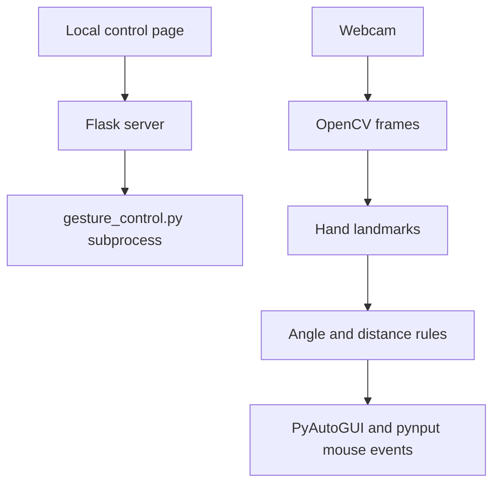

<a id="top"></a>

<div align="center">

# 🖐️ Hand Gesture Mouse

**A local computer-vision prototype that maps hand gestures to desktop mouse actions.**


[Repository](https://github.com/ashishgiije/Hand-Gesture-Mouse) · [Overview](#overview) · [Architecture](#architecture) · [Setup](#setup) · [Validation](#testing-and-validation) · [Audit](AUDIT_REPORT.md)

</div>

## Overview

A desktop interaction experiment using webcam hand landmarks to move the pointer and trigger clicks. A Flask page starts or stops the gesture subprocess on the machine running the server. It does not control a remote visitor’s webcam or browser pointer. The implementation uses pretrained landmark tracking and hand-written thresholds rather than a custom-trained gesture classifier.

## Visual preview

**Screenshot placeholder:** No verified application screenshot is supplied here. Capture the local start/stop page and webcam landmark overlay without private desktop content. No image is fabricated.

## Key features

- Index-tip pointer positioning with a gesture gate.
- Left, right, and double click classification from finger angles and distances.
- Gesture-triggered screenshots saved to the working directory.
- Separate drag-and-drop experiment in `gesture.py`.
- Local Flask start/stop subprocess controls.

## Technology stack

| Technology | Role in this checkout |
|---|---|
| Python + OpenCV | Webcam capture and preview |
| MediaPipe Hands | Hand landmarks |
| NumPy | Geometric calculations |
| PyAutoGUI + pynput | Desktop pointer actions and screenshots |
| Flask | Local start/stop control page |

## Architecture



## Application workflow

Open the local control page → start the script → allow webcam capture on the host → detect hand landmarks → apply thresholds → move/click/capture on the host desktop → stop from the page or press `q` in the OpenCV window.

## Setup

```bash
git clone https://github.com/ashishgiije/Hand-Gesture-Mouse.git
cd Hand-Gesture-Mouse
```

Use a local graphical desktop, webcam, Python virtual environment, and OS permissions for camera, input automation, and screen capture. There is no pinned dependency manifest. A candidate dependency installation matching imports is:

```bash
python3 -m venv .venv
. .venv/bin/activate
pip install flask opencv-python "mediapipe<0.10.30" pyautogui numpy pynput
python server.py
```

Open `http://127.0.0.1:5000`. Run from the repository root because the subprocess and template paths are relative. MediaPipe must provide the legacy `mp.solutions.hands` API; compatibility is not locked or fully validated here. Alternatively run `python gesture_control.py` directly, or `python gesture.py` for the separate drag demo. Keep the Flask development server local; it has no account security.

## Project structure

```text
server.py            # Local Flask subprocess controller
gesture_control.py   # Landmark-to-mouse rule engine
gesture.py           # Independent drag-and-drop prototype
util.py              # Angle and distance helpers
templates/index.html # Start/stop UI
```

## Local control API

| Method | Path | Behavior |
|---|---|---|
| GET | `/` | Render control page |
| POST | `/start-script` | Spawn gesture_control.py |
| POST | `/stop-script` | Terminate stored subprocess |
| GET | `/login` | Render the same control page; no authentication |
| GET | `/signup`, `/about` | Currently fail because templates are missing |

The start route returns a JSON `message`. Calls affect the host desktop; use the UI locally.

## Vision approach

MediaPipe supplies pretrained hand landmarks. `util.py` measures angles and normalized distances; rules choose pointer movement, click, double click, or screenshot. There is no training dataset or measured accuracy evaluation in this checkout. Detection thresholds are implementation parameters, not benchmark results.

## Testing and validation

Current source review and checks (4 November 2026):

Flask test client: `/` and `/login` returned HTTP 200; `/signup` and `/about` returned HTTP 500 because templates are missing. No webcam, click, or screenshot actions were executed.

Use the setup commands above and the documented workflow for a local smoke check. No passing automated application suite is claimed where none exists.

## Limitations and roadmap

- Hardware-dependent gesture behavior was not executed in the cloud machine.
- No click debounce: holding a gesture can repeat actions every frame.
- Authentication links are placeholders, and signup/about templates are missing.
- Screenshot files already tracked in the repository may contain desktop information; they are not reused as product previews.
- Suggested roadmap: pinned compatible dependencies, debouncing, robust process lifecycle, and hardware calibration tests.

<details>
<summary>Troubleshooting and contributions</summary>

Check the runtime versions and working directory first. For dependency installation failures, preserve TLS and checksum verification and inspect the first error. For external services, verify your local configuration and account permissions without sharing secret values.

Before contributing, read [the audit](AUDIT_REPORT.md), reproduce the affected behavior, and keep documentation changes separate from application fixes. Add tests for changed behavior and describe remaining limitations accurately.

</details>

## Author

**Ashish Gije** · [GitHub](https://github.com/ashishgiije)

[Back to top](#top)
